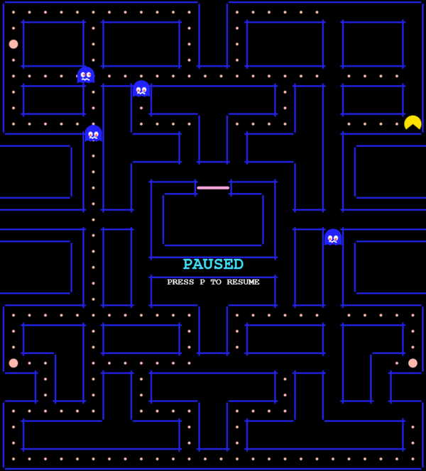
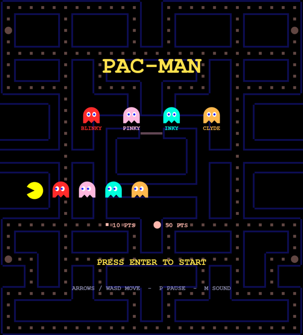
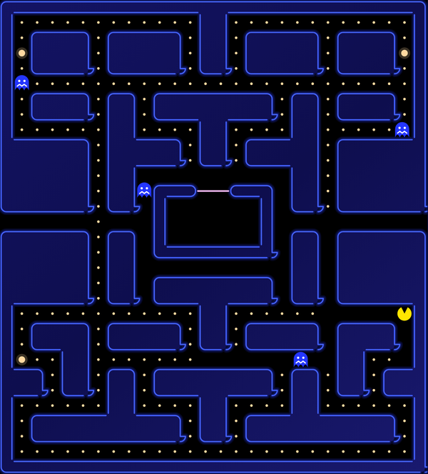
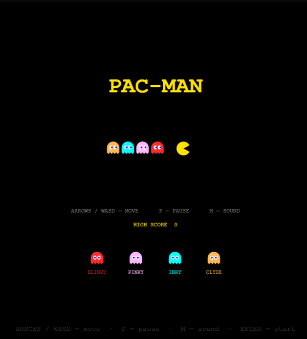
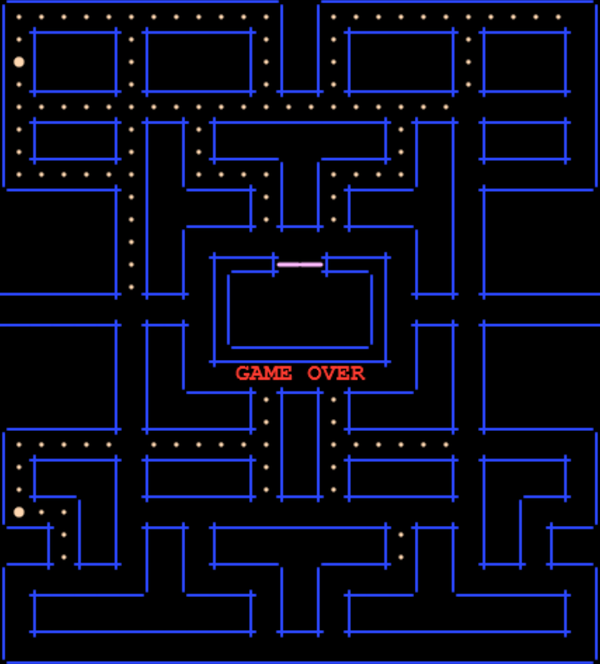
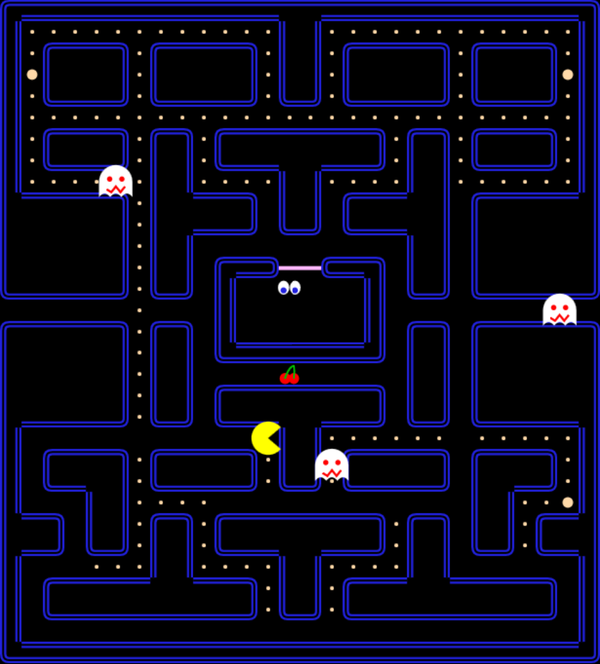
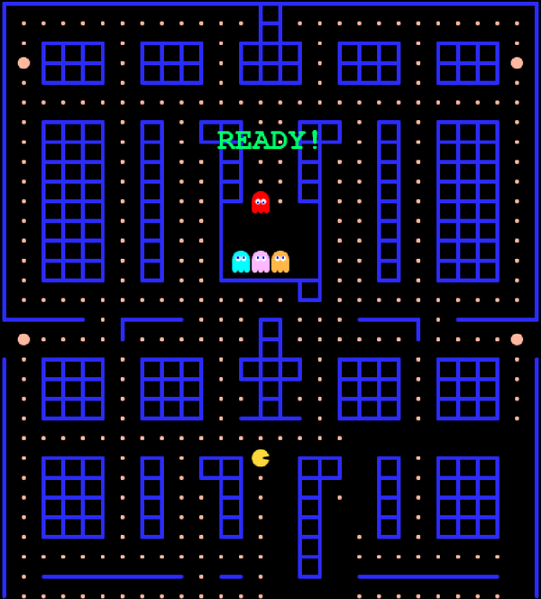

# Local LLM: Pac-Man built by local models

An ongoing collection of Pac-Man games built by open-weights models running on our own hardware. The collection grows as we test more models and setups.

Each run starts with the same prompt. The model works through an agent harness with shell and file access, and a browser for verification, until it reports completion. No hosted model APIs or follow-up instructions are used.

Every game is published as delivered, without manual code changes, so you can play and compare the results.

Some of our favorites:

<table>
<tr>
<td width="33%"><a href="#qwen3.8-flash-next-w4b-hgn-omp-xhigh"></a></td>
<td width="33%"><a href="#glm-5.3-flash-exl3-4bpw-zcode-max"></a></td>
<td width="33%"><a href="#deepseek-v4.1-flash-exl3-2.9bpw-dsh-max"></a></td>
</tr>
<tr>
<td width="33%"><a href="#glm-5.3-flash-exl3-4bpw-tensorfold-zcode-max"></a></td>
<td width="33%"><a href="#qwen3.8-flash-next-nvfp4-dsh-medium"></a></td>
<td width="33%"><a href="#deepseek-v4.1-flash-exl3-2.8bpw-dsh-max"></a></td>
</tr>
</table>

## The Prompt

Each LLM was asked to one-shot a Pac-Man clone with the following prompt:

```text
[INTENT] Build a complete, playable Pac-Man clone as a self-contained HTML page that runs
         by double-clicking the file.

[SCOPE]
  - Classic Pac-Man gameplay: navigate maze, eat dots, avoid ghosts
  - Core mechanics: maze with walls, dot collection, score, lives, 4 ghosts, power pellets
    with frightened-ghost mode
  - Standard arcade elements: 4 ghosts with distinct AI personalities, wrap-around tunnel,
    multiple levels

[APPROACH]
  - Single pacman.html file with inline <style> and <script>
  - HTML5 Canvas for rendering (grid-based maze, ~28x31 tiles like the original)
  - Vanilla JavaScript, no frameworks
  - Keyboard controls: arrow keys + WASD

[CONSTRAINTS]
  - Must work offline by opening the file directly in a browser
  - No external dependencies, CDNs, or asset files
  - No build step

[DELIVERABLE]
  - One complete pacman.html file

[DONE WHEN]
  - Game launches by double-clicking the file
  - Pac-Man moves with keyboard and respects maze walls
  - Dots are eatable; score increments
  - 4 ghosts move with distinct behaviors and chase Pac-Man
  - Power pellets turn ghosts vulnerable; eating a vulnerable ghost resets that ghost
  - Pac-Man loses a life on ghost contact when not powered
  - Game ends at 0 lives; restart works
  - Score and lives visible on screen
```

Prompt credit: DominguesM / [GLM-5.2 One-Shot Pac-Man Benchmark](https://github.com/DominguesM/glm5.2-pacman-oneshot)

## The Results

Prefill and decode are averages over the whole run. Prefill is the prompt tokens the engine computed
(prefix-cache hits excluded) over the time to first token (Halogen: its prompt-processing time);
decode is the output tokens over their generation time. Output tokens include the model's reasoning.
Time runs from the prompt to the model's final answer, taken from the harness's own session log.
Each Quant links to that run's notes under The Runs.

### AMD Strix Halo

A GMKtec EVO-X3 (AMD Strix Halo, Radeon 8060S) with 128 GB of unified memory. Halogen ran speculative
decoding with the model's MTP head.

#### Qwen3.8-Flash-Next

| Quant | Engine | Harness | Effort | Prefill | Decode | In Tok | Out Tok | Time |
|---|---|---|---|---|---|---|---|---|
| [W4B (HGN)](#qwen3.8-flash-next-w4b-hgn-omp-xhigh) | Halogen | OMP | XHigh | 965 t/s | 39.9 t/s | 3.52M | 0.26M | 117m06s |

### 2× NVIDIA DGX Spark

Two NVIDIA DGX Sparks (GB10 Grace Blackwell, 128 GB unified memory each), cabled directly to each other
over QSFP112 with RoCE, the model split across both with tensor parallelism (TP=2). Every engine here ran
speculative decoding.

#### DeepSeek-V4.1-Flash

| Quant | Engine | Harness | Effort | Prefill | Decode | In Tok | Out Tok | Time |
|---|---|---|---|---|---|---|---|---|
| [EXL3 2.8 bpw](#deepseek-v4.1-flash-exl3-2.8bpw-dsh-max) | TensorFold | DSH | Max | 840 t/s | 75.3 t/s | 8.96M | 0.16M | 40m09s |
| [EXL3 2.9 bpw](#deepseek-v4.1-flash-exl3-2.9bpw-dsh-max) | vLLM | DSH | Max | 575 t/s | 36.3 t/s | 7.00M | 0.15M | 79m47s |

#### GLM-5.3-Flash

| Quant | Engine | Harness | Effort | Prefill | Decode | In Tok | Out Tok | Time |
|---|---|---|---|---|---|---|---|---|
| [EXL3 4 bpw](#glm-5.3-flash-exl3-4bpw-tensorfold-zcode-max) | TensorFold | ZCode | Max | 1,608 t/s | 53.5 t/s | 4.53M | 0.12M | 38m37s |
| [EXL3 4 bpw](#glm-5.3-flash-exl3-4bpw-zcode-max) | vLLM | ZCode | Max | 976 t/s | 29.0 t/s | 2.86M | 0.11M | 65m58s |

#### Qwen3.8-Flash-Next

| Quant | Engine | Harness | Effort | Prefill | Decode | In Tok | Out Tok | Time |
|---|---|---|---|---|---|---|---|---|
| [NVFP4](#qwen3.8-flash-next-nvfp4-dsh-medium) | vLLM | DSH | Medium | 2,281 t/s | 41.9 t/s | 2.99M | 0.07M | 27m34s |

### Radeon AI Pro R9700 (USB4)

One AMD Radeon AI PRO R9700 (32 GB) in an external dock over USB4, attached to the same GMKtec EVO-X3.
vLLM ran speculative decoding with a DFlash drafter.

#### Qwen3.8-27B

| Quant | Engine | Harness | Effort | Prefill | Decode | In Tok | Out Tok | Time |
|---|---|---|---|---|---|---|---|---|
| [MXFP4](#qwen3.8-27b-mxfp4-dsh-xhigh) | vLLM ROCm | DSH | XHigh | 1,462 t/s | 90.8 t/s | 6.07M | 0.14M | 30m31s |

**Components:**
- Models: [Qwen3.8-Flash-Next NVFP4](https://huggingface.co/nvidia/Qwen3.8-Flash-Next-NVFP4) (NVIDIA),
  [DeepSeek-V4.1-Flash EXL3 2.9 bpw](https://huggingface.co/Mia-AiLab/DeepSeek-V4.1-Flash-EXL3-2.9bpw) (Mia-AiLab),
  GLM-5.3-Flash EXL3 4 bpw (Mia-AiLab),
  [Qwen3.8-27B MXFP4](https://huggingface.co/amd/Qwen3.8-27B-Quark-AWQ-MXFP4) (AMD),
  [Qwen3.8-Flash-Next for Halogen](https://huggingface.co/peonist-ai/halogen-qwen3.8-flash-next) (peonist-ai),
  [DeepSeek-V4.1-Flash EXL3 2.8 bpw](https://huggingface.co/jayleaton/DeepSeek-V4.1-Flash-EXL3-2.8bpw) (jayleaton).
- Serving recipes and engines: [GLM-5.3-Flash-EXL3-2x-DGX-Sparks](https://github.com/MiaAI-Lab/GLM-5.3-Flash-EXL3-2x-DGX-Sparks),
  [DeepSeek-v4.1-Flash-EXL3-2x-DGX-Sparks](https://github.com/MiaAI-Lab/DeepSeek-v4.1-Flash-EXL3-2x-DGX-Sparks),
  [vllm-mxfp4](https://github.com/GGZ14/vllm-mxfp4) (GGZ14),
  [Halogen flash server](https://github.com/peonist-ai/halogen-flash-server) (peonist-ai),
  [deepseek-v41-tensorfold-spark](https://github.com/jayleaton/deepseek-v41-tensorfold-spark) (jayleaton).
- Harnesses: [DeepSeek Harness](https://www.deepseek.com/en/harness/) (DeepSeek), [ZCode](https://zcode.z.ai/en) (Z.ai),
  [OMP](https://omp.sh/) (oh-my-pi).

## The Runs

### AMD Strix Halo

#### Qwen3.8-Flash-Next

<a name="qwen3.8-flash-next-w4b-hgn-omp-xhigh"></a>

<table>
<tr>
<td valign="top" width="65%">

##### W4B (HGN), Halogen, OMP, XHigh

Early in the run Qwen searched the web for the original maze as a 28×31 text map, then wrote a
script that checked its maze for symmetry and that all 240 dots and 4 power pellets could be
reached. It drove the game in headless Chromium from the shell and looked at nine screenshots of
its own game, from the title screen to level 2. About 212,000 of its 257,000 output tokens were
reasoning. 70 tool calls (11 returned errors), one context compaction, 1 h 57 min. 89.7% of its
3.5 million prompt tokens were served from the prefix cache.

[▶ Play](https://ilonalumina.github.io/local-llm-pac-man/runs/qwen3.8-flash-next-w4b-hgn-omp-xhigh/) ·
[Source](runs/qwen3.8-flash-next-w4b-hgn-omp-xhigh/pacman.html)

</td>
<td width="35%"><a href="https://ilonalumina.github.io/local-llm-pac-man/runs/qwen3.8-flash-next-w4b-hgn-omp-xhigh/"></a></td>
</tr>
</table>

### 2× NVIDIA DGX Spark

#### DeepSeek-V4.1-Flash

<a name="deepseek-v4.1-flash-exl3-2.8bpw-dsh-max"></a>

<table>
<tr>
<td valign="top" width="65%">

##### EXL3 2.8 bpw, TensorFold, DSH, Max

DeepSeek worked out the maze, the start tile and the ghost-house exit lane from its own knowledge of
the arcade game; web search was available and not called. It wrote a headless Node harness that runs
the game's own script against a stubbed DOM (89 assertions plus random-input soak runs) and fixed the
three bugs it found. It then served the file locally, opened it in the harness's browser, drove it
from an instrumented test page and looked at its own screenshots (4 page loads, 2 screenshots, 2 image
reads). 41 tool calls, zero errors, no context compaction, 40 min 9 s. 97.4% of its 9.0 million prompt
tokens were served from the prefix cache.

[▶ Play](https://ilonalumina.github.io/local-llm-pac-man/runs/deepseek-v4.1-flash-exl3-2.8bpw-dsh-max/) ·
[Source](runs/deepseek-v4.1-flash-exl3-2.8bpw-dsh-max/pacman.html)

</td>
<td width="35%"><a href="https://ilonalumina.github.io/local-llm-pac-man/runs/deepseek-v4.1-flash-exl3-2.8bpw-dsh-max/"></a></td>
</tr>
</table>

<a name="deepseek-v4.1-flash-exl3-2.9bpw-dsh-max"></a>

<table>
<tr>
<td valign="top" width="65%">

##### EXL3 2.9 bpw, vLLM, DSH, Max

This serve ran with vision off; a vision plugin routed DeepSeek's image questions to Gemma4:26b on
one NVIDIA RTX-3090. It had the harness's browser tools but did not use them. Instead
it wrote a script that set the game up in several states, from the title
screen to game over, rendered each with headless Chromium from the shell, and asked the vision
model about the frames (22 vision calls; the plugin's own screenshot tool could not start its
sandboxed Chrome). 69 tool calls, 80 minutes. 97.5% of its 7.0 million prompt tokens were served from
the prefix cache.

[▶ Play](https://ilonalumina.github.io/local-llm-pac-man/runs/deepseek-v4.1-flash-exl3-2.9bpw-dsh-max/) ·
[Source](runs/deepseek-v4.1-flash-exl3-2.9bpw-dsh-max/pacman.html)

</td>
<td width="35%"><a href="https://ilonalumina.github.io/local-llm-pac-man/runs/deepseek-v4.1-flash-exl3-2.9bpw-dsh-max/"></a></td>
</tr>
</table>

#### GLM-5.3-Flash

<a name="glm-5.3-flash-exl3-4bpw-tensorfold-zcode-max"></a>

<table>
<tr>
<td valign="top" width="65%">

##### EXL3 4 bpw, TensorFold, ZCode, Max

GLM wrote pacman.html in one pass and never edited it. It then wrote a headless Node harness that
runs the game's logic, with a random-input bot playing it, and ran it four times; the failures it
reported were in the harness's own checks, which it corrected between runs. It confirmed the file has
no external references, rendered test copies in headless Chromium from the shell and looked at its own
screenshots of the title screen, play and frightened mode (4 image reads). 25 tool calls, zero errors,
no context compaction, 38 min 37 s. 95.7% of its 4.5 million prompt tokens were served from the
prefix cache.

[▶ Play](https://ilonalumina.github.io/local-llm-pac-man/runs/glm-5.3-flash-exl3-4bpw-tensorfold-zcode-max/) ·
[Source](runs/glm-5.3-flash-exl3-4bpw-tensorfold-zcode-max/pacman.html)

</td>
<td width="35%"><a href="https://ilonalumina.github.io/local-llm-pac-man/runs/glm-5.3-flash-exl3-4bpw-tensorfold-zcode-max/"></a></td>
</tr>
</table>

<a name="glm-5.3-flash-exl3-4bpw-zcode-max"></a>

<table>
<tr>
<td valign="top" width="65%">

##### EXL3 4 bpw, vLLM, ZCode, Max

GLM wrote a headless Node test suite for the game logic and ran it three times. It then served
the file over a local web server, loaded ZCode's browser skill and played the game in the
harness's browser (11 browser calls). Its last check confirmed the file has no external
references. 28 tool calls, zero errors, 66 minutes. 96.4% of its 2.9 million prompt tokens were served
from the prefix cache.

[▶ Play](https://ilonalumina.github.io/local-llm-pac-man/runs/glm-5.3-flash-exl3-4bpw-zcode-max/) ·
[Source](runs/glm-5.3-flash-exl3-4bpw-zcode-max/pacman.html)

</td>
<td width="35%"><a href="https://ilonalumina.github.io/local-llm-pac-man/runs/glm-5.3-flash-exl3-4bpw-zcode-max/"></a></td>
</tr>
</table>

#### Qwen3.8-Flash-Next

<a name="qwen3.8-flash-next-nvfp4-dsh-medium"></a>

<table>
<tr>
<td valign="top" width="65%">

##### NVFP4, vLLM, DSH, Medium

Qwen tested in the harness's browser: it opened its own `pacman.html`, took screenshots, read
the page text and ran script in the page (10 browser calls). 46 tool calls, 66K output tokens,
27½ minutes. 95.1% of its 3.0 million prompt tokens were served from the prefix cache.

[▶ Play](https://ilonalumina.github.io/local-llm-pac-man/runs/qwen3.8-flash-next-nvfp4-dsh-medium/) ·
[Source](runs/qwen3.8-flash-next-nvfp4-dsh-medium/pacman.html)

</td>
<td width="35%"><a href="https://ilonalumina.github.io/local-llm-pac-man/runs/qwen3.8-flash-next-nvfp4-dsh-medium/"></a></td>
</tr>
</table>

### Radeon AI Pro R9700 (USB4)

#### Qwen3.8-27B

<a name="qwen3.8-27b-mxfp4-dsh-xhigh"></a>

<table>
<tr>
<td valign="top" width="65%">

##### MXFP4, vLLM ROCm, DSH, XHigh

Qwen wrote the game in one file, ran a headless simulation of the game logic, then opened the
game in the harness's browser and looked at its own screenshots (3 page loads, 3 screenshots, 3
image reads). 38 tool calls, one context compaction, 30 min 31 s. 93.7% of its 6.1 million prompt
tokens were served from the prefix cache.

[▶ Play](https://ilonalumina.github.io/local-llm-pac-man/runs/qwen3.8-27b-mxfp4-dsh-xhigh/) ·
[Source](runs/qwen3.8-27b-mxfp4-dsh-xhigh/pacman.html)

</td>
<td width="35%"><a href="https://ilonalumina.github.io/local-llm-pac-man/runs/qwen3.8-27b-mxfp4-dsh-xhigh/"></a></td>
</tr>
</table>

## Run It Yourself

Each game is one self-contained HTML file. Download any `pacman.html` and double-click it.

## License

[MIT](LICENSE)
